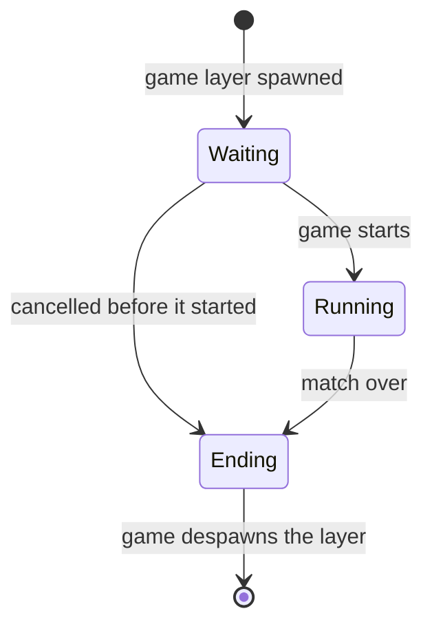

# Game phase

A game layer holds exactly one game phase. A phase is a type, so a system selects games by phase in its query (`Query<Game<Running>>`), and `transition::<From, To>()` only compiles for the edges below.

| From | To | When |
| --- | --- | --- |
| (none) | Waiting | A layer gains `GameLayer`. Every new game starts waiting. |
| Waiting | Running | The game decides the match starts, usually when the layer is full enough. |
| Waiting | Ending | The game cancels the match before it started. |
| Running | Ending | The game decides the match is over. |
| Ending | (none) | The game wraps up and despawns the layer, which frees its players. |

Only a waiting game has free slots, so only a waiting game takes players. A full waiting game is still waiting: it has zero free slots. A transition is a no-op when the game already left `From`, so two systems racing to move the same game on never skip a phase. Nothing stops a game from despawning its layer in any phase; the edge from Ending is the normal end.
