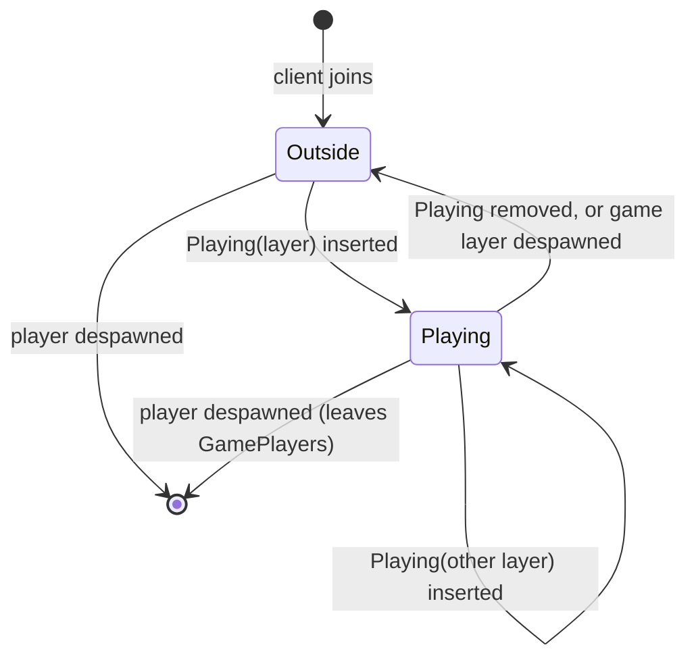

# Player in game

A player is in at most one game: `Playing(layer)` on the player, with the layer listing it in `GamePlayers`.

| From | To | When |
| --- | --- | --- |
| Outside | Playing | `Playing(layer)` is inserted, by the queue or directly. The player moves into the game layer; where it stands there is the game's choice. |
| Playing | Playing | `Playing` is inserted again with another layer. The player leaves the first game and moves into the second. |
| Playing | Outside | `Playing` is removed, or its game layer is despawned. The player stays where it stands; moving it back is the caller's job. |
| any | (none) | The player despawns. Its game, if any, lists it no more. |

Seen from the queue, Playing is the busy queue status and Outside is free or queued.
