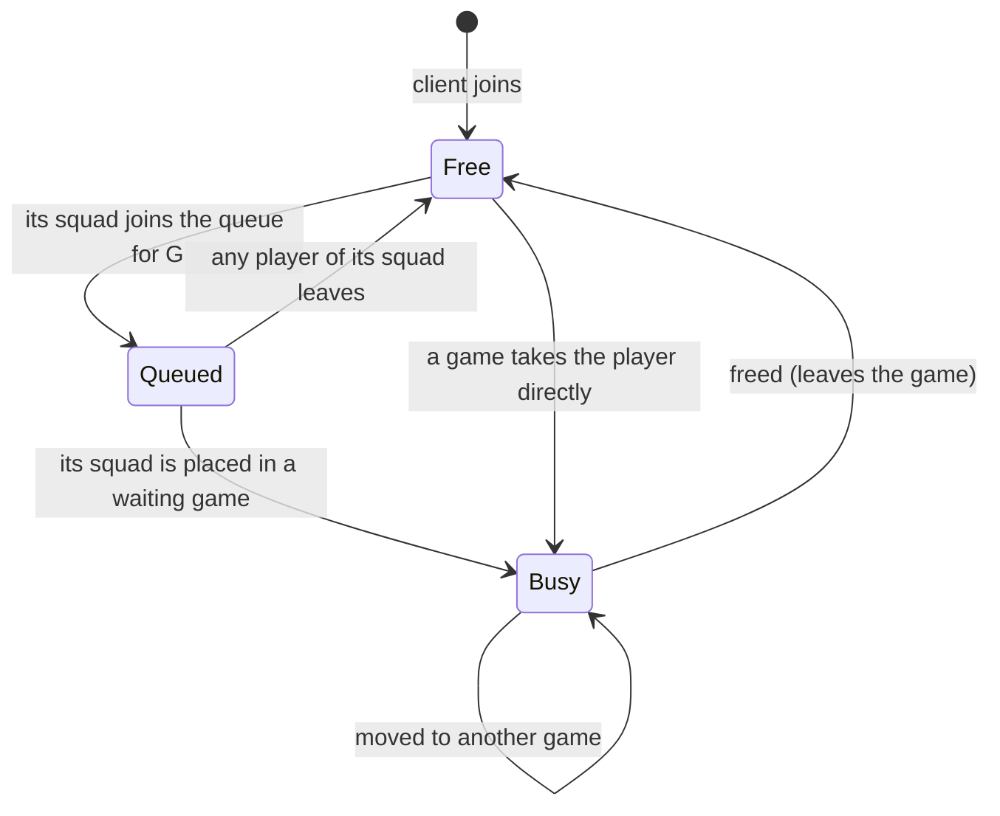

# Queue status

Every player has exactly one queue status. A status is a type, so a system selects players by status in its query, the way it selects games by phase, and only the edges below compile.

| From | To | When |
| --- | --- | --- |
| Free | Queued&lt;G&gt; | The player joins the queue for mini game `G` with its squad. Every player of the squad must be free. |
| Queued&lt;G&gt; | Free | Any player of its squad leaves the queue. The whole squad becomes free. |
| Queued&lt;G&gt; | Busy | The queue places its squad of n players in a waiting game of `G` with n free slots. |
| Free | Busy | A game takes the player without the queue. |
| Busy | Busy | The player is moved straight from one game into another. |
| Busy | Free | The player leaves the game, or its game layer is despawned. |

There is no edge out of Busy except to Free, so a player in a game can't queue.
