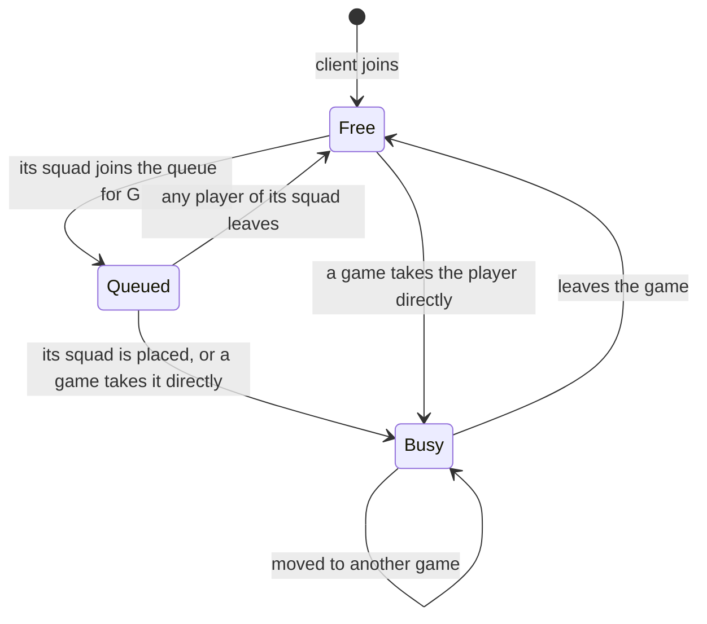

# Queue status

Every player has exactly one queue status: the marker `Free`, `Queued<G>` or `Busy`. A system selects players by status in its query, `Query<Entity, With<Free>>`, the way it selects games by phase. Callers don't set statuses: the queue moves players along the edges below, on `QueueMessage` and on `Playing`.

| From | To | When |
| --- | --- | --- |
| (none) | Free | A client joins the server. |
| Free | Queued&lt;G&gt; | `QueueMessage::Join` for `G` names the player's squad. Every player of the squad must be free, and `G` must have a `GameQueuePlugin`. |
| Queued&lt;G&gt; | Free | Any player of its squad leaves the queue (`QueueMessage::Leave`), despawns, or is taken into a game directly. The whole squad becomes free. |
| Queued&lt;G&gt; | Busy | The queue places its squad of n players in a waiting game of `G` with n free slots. Or a game takes this player directly, which frees the rest of its squad. |
| Free | Busy | A game takes the player without the queue: it gains `Playing`. |
| Busy | Busy | The player is moved straight from one game into another. |
| Busy | Free | The player loses `Playing`: it leaves the game, or its game layer is despawned. |

There is no edge from Busy to Queued: only free players can queue.
