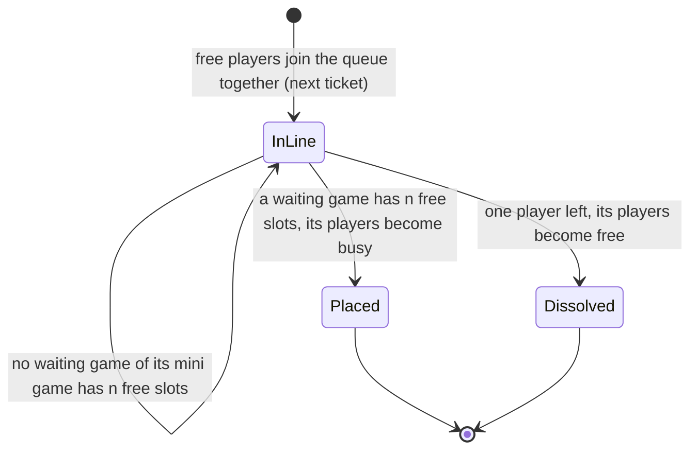

# Squad

A squad is n players (1..n) in line together for a mini game. It forms when they join the queue and ends when it is placed in a game or one of its players leaves the queue, despawns, or is taken into a game directly. A squad is never split: all n players are placed, or all n are free again.

| From | To | When |
| --- | --- | --- |
| (none) | In line | 1..n players, all free, join the queue for a mini game together. The squad takes the next ticket. |
| In line | In line | Every tick that no waiting game of its mini game has n free slots. |
| In line | Placed | A waiting game of its mini game has n free slots. All n players become busy in that game, and the squad is gone. |
| In line | Dissolved | One of its players leaves the queue, despawns, or is taken into a game directly. The others become free, and the squad is gone. |

Each tick, every waiting game takes squads of its mini game in ticket order, first fit: a squad larger than the slots left stays in line, and smaller squads behind it can be placed before it.
